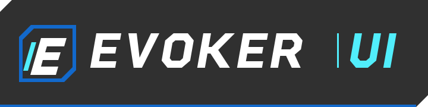

<p align="center">
  
</p>

<p align="center"><strong>Sharp surfaces. Independent motion. Your application.</strong></p>

<div align="center">

[](https://github.com/KartikeyaKotkar/evoker/actions/workflows/ci.yml)
[](LICENSE)

[](.nvmrc)
[](react/package.json)
[](tsconfig.base.json)
[](CONTRIBUTING.md)

</div>

# Evoker UI

A **Persona 3 Reload–inspired React component library** with original geometry and an engine-independent TypeScript motion core. Compose everyday primitives or start with a more expressive block. Your application owns its content, data and async operations.

[Playground](https://kartikeyakotkar.github.io/evoker/) · [Documentation](https://kartikeyakotkar.github.io/evoker/#/docs) · [Install](https://kartikeyakotkar.github.io/evoker/#/docs/installation) · [Components](#what-you-can-build) · [Contribute](CONTRIBUTING.md) · [Report a bug](https://github.com/KartikeyaKotkar/evoker/issues/new/choose) · [Brand assets](docs/BRAND.md)

## What you can build

- **Everyday UI:** buttons, inputs, fields, checkboxes, switches, sliders, selects, dialogs, tabs, cards, tooltips and dropdown menus. Base UI owns complex form, focus and overlay behavior.
- **Expressive blocks:** eighteen optional compositions, including party panels, quest briefs, dialogue, message logs, comparisons, result summaries, cut-ins and code blocks.
- **Independent motion:** DOM-free timelines, sequences, playback, interruptions and input helpers in `@kartikeyak/evoker-core`, with zero runtime dependencies.
- **A theme you can own:** light/dark appearance, density, semantic color tokens and theme inheritance through portals. No Tailwind setup is needed.
- **Keyboard and motion preferences:** native editing and form participation, scoped playground navigation, reduced-motion support and real-browser regression checks.

All 27 playground entries have dedicated, searchable documentation pages with live examples, code and API contracts. See the [block contracts](docs/EXPANDED_COMPONENTS.md) and [architecture](docs/ARCHITECTURE.md) for more detail.

## Try the playground

Use **Node.js 24** and npm. `.nvmrc` matches CI. No game installation is required.

```sh
git clone https://github.com/KartikeyaKotkar/evoker.git
cd evoker
npm ci
npm run dev
```

Open the URL printed by Vite:

- `/` opens **P3R Blocks & Motion**, the standalone interactive front page.
- `/#/docs` opens **documentation**, including installation, theming and every playground component.

The opening menu is keyboard-ready. Click a demo or Tab into it; arrows navigate, Enter/Space activates and Escape goes back. Native inputs, sliders, selects, nested menus and modal focus retain their own behavior.

## Use Evoker in your application

**The public beta is available on npm:** [@kartikeyak/evoker](https://www.npmjs.com/package/@kartikeyak/evoker) and [@kartikeyak/evoker-core](https://www.npmjs.com/package/@kartikeyak/evoker-core).

In an existing React 18 or 19 application:

```sh
npm install @kartikeyak/evoker@beta
```

npm installs the matching `@kartikeyak/evoker-core` and Base UI dependencies automatically. React and React DOM are peer dependencies. The beta API may change before 1.0.

For a reproducible beta installation:

```sh
npm install @kartikeyak/evoker@0.1.0-beta.1
```

For local development, build and install the tested archives:

```sh
# In the cloned Evoker repository, after npm ci
npm run package

# In your React application; replace the path
npm install /path/to/evoker/artifacts/npm/kartikeyak-evoker-core-0.1.0-beta.1.tgz \
  /path/to/evoker/artifacts/npm/kartikeyak-evoker-0.1.0-beta.1.tgz
```

Packages include ESM, TypeScript declarations, styles, installation instructions and the MIT license. Import the stylesheet once in your application entry or root layout.

```tsx
import { useState } from 'react';
import { Button, Gauge, Panel, Theme } from '@kartikeyak/evoker';
import '@kartikeyak/evoker/styles.css';

export function App() {
  const [reviewed, setReviewed] = useState(0);

  return (
    <Theme appearance="dark" reducedMotion="system">
      <Panel title="Session workspace" eyebrow="Recordings / 01" tone="dark">
        <p>Review your recordings, one signal at a time.</p>
        <Gauge label="Recordings reviewed" value={reviewed} max={3} />
        <Button disabled={reviewed === 3}
          onClick={() => setReviewed(value => Math.min(3, value + 1))}>
          {reviewed === 3 ? 'All reviewed' : 'Review next recording'}
        </Button>
      </Panel>
    </Theme>
  );
}
```

Root imports remain available. Smaller entries include `/button`, `/theme`, `/controls`, `/dialog`, `/tabs` and `/blocks`. Import global CSS once, from your application's root layout where required. Interactive entries declare `use client` for frameworks such as Next.js.

## Find your way around

| Area | What lives there |
| --- | --- |
| [`core`](core) | Engine-independent motion and interaction |
| [`react`](react) | Components, blocks, theme and DOM renderer |
| [`playground`](playground) | Front page, shared demos and documentation app |
| [`assets/brand`](assets/brand) | Official editable SVG mark and wordmark |
| [`docs`](docs) | Architecture, contracts, testing and source policy |

## Contribute

Clear bug reports, accessibility improvements, keyboard regressions and better examples are all useful contributions. Small fixes are welcome; discuss a new public API or broad redesign in an issue first.

1. Read [CONTRIBUTING.md](CONTRIBUTING.md) for setup, ownership and relevant checks.
2. Use a [bug report or feature proposal](https://github.com/KartikeyaKotkar/evoker/issues/new/choose), or open a focused pull request.
3. Explain the problem, resulting behavior and verification. Include screenshots for visual changes.

The repository includes issue forms, a pull-request template, a [code of conduct](CODE_OF_CONDUCT.md) and [private security reporting](SECURITY.md). No CLA or sign-off process is required.

## Checks

```sh
npm test                 # Motion core unit tests
npm run typecheck        # All workspaces
npm run test:browser     # Real Chromium interactions and responsive layouts
npm run test:package     # Build, archives and an independent consumer
```

CI runs these checks for pull requests and pushes to `main`. The browser suite needs installed Chrome/Chromium; use `CHROME_PATH` for a custom path. The package check needs npm registry access. Read the [test guide](docs/TESTING.md) for regression cases and screenshot options.

## License and identity

Project-authored code, geometry, documentation and the [official SVG logo](docs/BRAND.md) are available under the [MIT license](LICENSE). Dependencies retain their own licenses.

Game artwork, fonts, encryption keys, extracted tables and private research are excluded from the repository and packages. Static references inform composition; exact game runtime fidelity remains unverified. See the [source policy](docs/SOURCE_POLICY.md).
